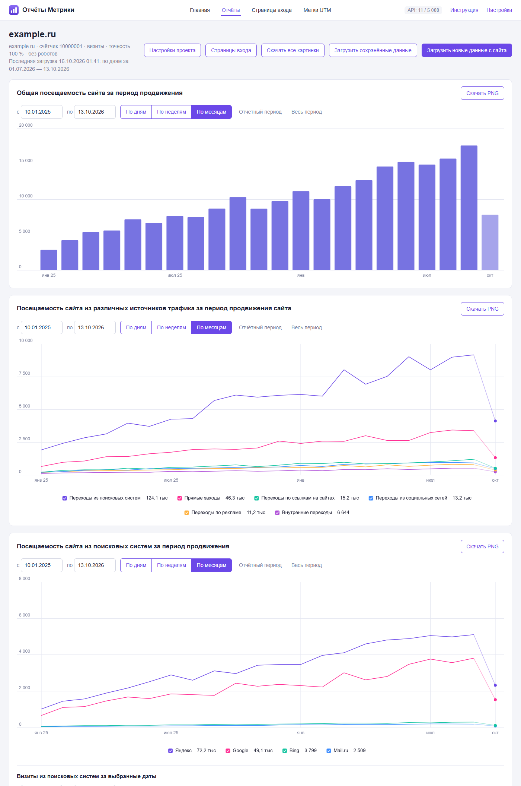
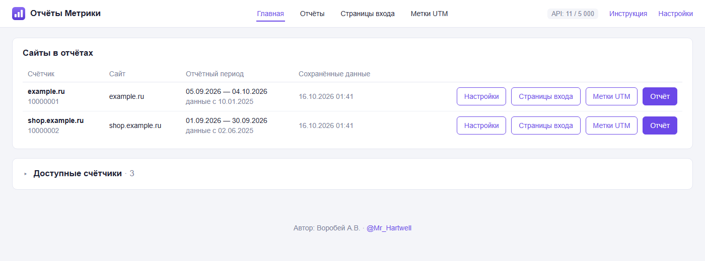
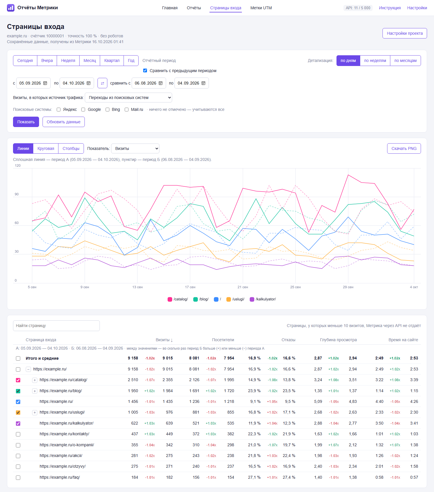
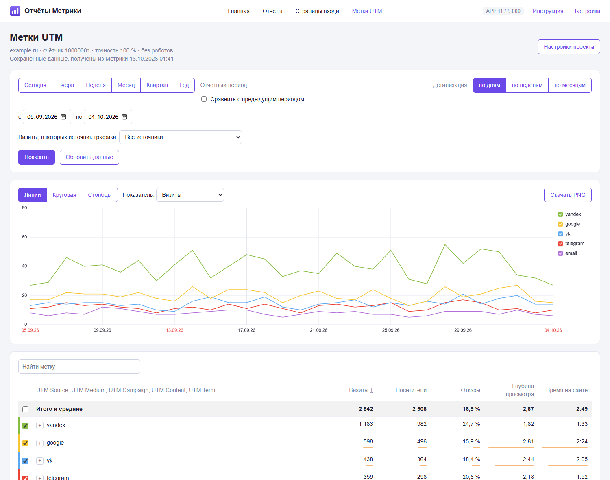

# Отчёты Метрики

Программа для Windows, которая забирает статистику посещаемости из Яндекс Метрики и строит
отчёты в стиле самой Метрики — для SEO-отчётов клиентам. Данные берутся с точностью 100 %
(без семплирования) и без роботов.

**[⬇ Скачать последнюю версию](../../releases/latest)** — файл `metrika-reports.exe`.

## Что умеет

- **Отчёт по посещаемости** — три графика: общая посещаемость, источники трафика и поисковые
  системы. Даты и детализация (по дням, неделям, месяцам) выбираются над каждым графиком.
  Графики скачиваются картинками PNG — по одному или все сразу архивом.
- **Страницы входа** — раскрывающееся дерево страниц, как в Метрике: сравнение двух периодов,
  отбор по источнику трафика и поисковым системам, графики и таблица с визитами, посетителями,
  отказами, глубиной и временем на сайте.
- **Метки UTM** — дерево UTM Source → Medium → Campaign → Content → Term с графиком и таблицей.
- **Несколько сайтов и несколько логинов Яндекса** — у каждого сайта свой отчётный период,
  который может сдвигаться и загружаться автоматически.
- **Экономия лимитов API** — загруженное хранится на вашем компьютере и повторно не запрашивается;
  к Метрике программа обращается только по вашей кнопке (или по автозагрузке, если вы её включили)
  и заранее показывает, сколько запросов потребуется.

| | |
| --- | --- |
|  |  |
| Список сайтов | Страницы входа со сравнением периодов |
|  |  |
| Метки UTM | Отчёт по посещаемости |

Снимки сделаны на демонстрационных данных.

## Что нужно

- Windows 10 или 11, 64-разрядная.
- Любой браузер — программа открывается в нём.
- Доступ к счётчикам в Яндекс Метрике и OAuth-токен с правом чтения статистики (`metrika:read`).
  Как его получить — ниже.

## Установка и первый запуск

1. Скачайте `metrika-reports.exe` из [последней версии](../../releases/latest).
2. Создайте для программы отдельную папку на своём компьютере — например, `Документы\Отчёты Метрики` —
   и положите exe туда. Рядом с ним программа будет хранить свои данные, поэтому подойдёт
   любая папка, куда можно записывать файлы. Не кладите программу в `Program Files`
   и не запускайте её из общей сетевой папки.
3. Запустите `metrika-reports.exe`.

   **Windows может показать окно «Система Windows защитила ваш компьютер».** Так бывает
   с программами, у которых нет платной цифровой подписи. Нажмите «Подробнее» → «Выполнить
   в любом случае». Это нужно сделать один раз.
4. Откроется вкладка браузера с программой, а в трее, у часов, появится её иконка.
   Введите OAuth-токен, загрузите список счётчиков и добавьте нужные сайты.

Подробная пошаговая инструкция встроена в программу — ссылка «Инструкция» вверху любой страницы.

### Как получить OAuth-токен

1. Войдите в Яндекс под логином, у которого есть доступ к нужным счётчикам Метрики.
2. На [oauth.yandex.ru](https://oauth.yandex.ru/) создайте приложение и выдайте ему доступ
   «Яндекс Метрика — получение статистики».
3. Получите токен для этого приложения и вставьте его в программу.

Если счётчики лежат на разных логинах Яндекса, добавьте токен каждого логина в «Настройках».

## Как пользоваться

- Программа работает в фоне, без окна. **Двойной щелчок по иконке в трее** открывает её в браузере.
  Если иконки не видно, нажмите стрелку «^» рядом с часами.
- **Закрыть программу:** правая кнопка мыши по иконке → «Закрыть», или кнопка «Закрыть программу»
  в «Настройках». Закрытие вкладки браузера программу не останавливает.
- Повторный запуск exe не открывает вторую копию, а показывает уже работающую.

## Где хранятся данные

Всё хранится только на вашем компьютере, в папке программы:

- `metrika.db` — токены, сайты и загруженная статистика;
- `metrika.log` — журнал работы и ошибок.

Программа обращается только к API Яндекс Метрики (`api-metrika.yandex.net`) и больше никуда
данные не отправляет. Открывается она только на вашем компьютере (`127.0.0.1`) — с других
компьютеров сети к ней не подключиться.

**Токены хранятся в `metrika.db` в открытом виде** — не передавайте этот файл посторонним.

Чтобы перенести программу со всеми данными на другой компьютер, скопируйте exe вместе
с `metrika.db`.

## Обновление

1. Скачайте новую версию из [последнего выпуска](../../releases/latest).
2. Закройте программу: иконка в трее → «Закрыть».
3. На всякий случай сделайте копию файла `metrika.db`.
4. Замените `metrika-reports.exe` новым файлом и запустите его.

Данные прежних версий подхватываются автоматически. Возвращаться на старую версию после
обновления не рекомендуется: она может не увидеть сохранённые токены.

## Несколько компьютеров

На каждом компьютере программа работает со своей папкой и своими данными. Не запускайте один exe
из общей сетевой папки сразу с нескольких компьютеров — они будут писать в одну базу и могут её
повредить (программа предупредит об этом).

Лимиты API Метрики считаются на логин Яндекса: 5 000 запросов в сутки и 200 запросов к отчётам
за 5 минут. Если несколько компьютеров работают одним токеном, лимит у них общий.

## Ограничения

- По отдельным страницам сайта Метрика через API не отдаёт значения меньше 10 визитов,
  поэтому таких страниц в отчёте «Страницы входа» нет.
- Программа работает только в Windows.

## Условия использования

Программу можно бесплатно скачивать из этого репозитория и пользоваться ею. Распространять её,
изменять и разбирать нельзя. Полный текст — в файле [LICENSE](LICENSE).

## Автор

Воробей А.В. — [@Mr_Hartwell](https://t.me/Mr_Hartwell). Вопросы и сообщения об ошибках —
в Telegram. Если программа работает не так, приложите файл `metrika.log` из её папки.
